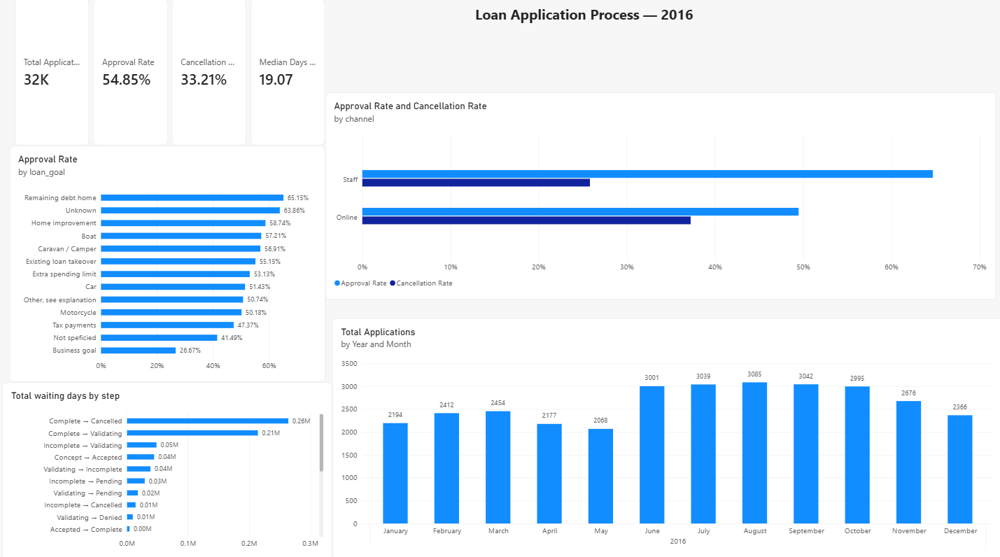
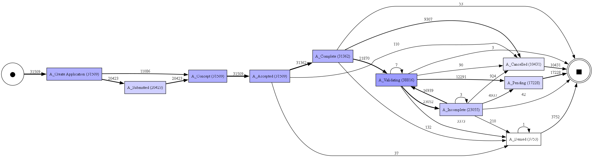

# Loan Application Process Analysis

Why do so many loan applications fail to become loans, and where does the time go?

I analysed every loan application a Dutch bank received online and through its staff in 2016 (31,509 applications, about 1.2 million recorded steps). I mapped the real process, measured where applications wait, built a Power BI dashboard, wrote up the business requirements a BA would hand to the bank, and added an AI assistant that answers questions about the data using SQL.

## The short version

- Only about 15% of applications go straight from start to approval without a detour.
- About 30% reach the offer stage and are then cancelled. 78% of those cancellations happen between 29 and 32 days after the offer, which looks like an automatic 30-day timeout.
- Around 70% of all waiting time happens after the bank sends an offer. The bank's own checks usually take less than a day.
- 69% of applications that reach validation get sent back at least once for missing documents.
- Online applications are cancelled more often than staff-entered ones (37% vs 26%).

My main recommendation is to contact customers during the offer period, for example reminders at day 7 and 14. Speeding up internal checks wouldn't help much, because that isn't where the time goes.

## How I did it

| Step | What I did | Where |
|---|---|---|
| Load | Converted the raw event log (XES format) into a table | `01_load_data.ipynb` |
| Data quality | Checked duplicates, missing values, odd timestamps, and decided how to handle each issue | `02_data_quality.ipynb` |
| Process mapping | Found the most common paths and drew the process map | `03_process_map.ipynb` |
| Bottlenecks | Measured waiting time between every pair of steps | `04_bottlenecks.ipynb` |
| SQL | Answered business questions in DuckDB | `05_sql_analysis.ipynb` |
| Dashboard | Cleaned data in Power Query, built KPIs with DAX | `images/dashboard.png` |
| AI assistant | Gemini writes SQL, DuckDB runs it, tested against known answers | `06_ai_assistant.ipynb` |

## Business analysis documents

- [Business requirements (BRD)](docs/BRD.md)
- [User stories with acceptance criteria](docs/user_stories.md)
- [Gap analysis](docs/gap_analysis.md)
- [As-is and to-be process](docs/process_as_is_to_be.md)
- [UAT test cases](docs/uat_test_cases.md)
- Jira board: [timeline](images/jira_timeline.png) and [sprint board](images/jira_board.png)

I didn't have access to anyone at the bank, so the requirements are based on the data alone. The BRD says so, and lists the questions I'd want to ask them.

## The AI assistant

You ask a question in plain English. Gemini writes a SQL query, DuckDB runs it on the real data, and Gemini sums up the result. Gemini never supplies a number on its own.

I tested it on 10 questions where I already knew the answer. It got all 10 right. Without the data, Gemini on its own got 1 of 10. It mostly admitted it didn't know, but a few answers were close and still wrong.

The test also caught a mistake of mine. I had written down 3,753 denied applications, but the correct number is 3,752, because one application had its outcome logged twice.

Ten simple questions is a small test. I haven't tested harder questions that need joins or several steps.

## Things I'd be careful about

- The data is from 2016. The bank's process has probably changed since.
- The 30-day timeout is my reading of the pattern. I can't confirm the bank's actual rule.
- About 3,000 applications have a requested amount of 0. I couldn't work out why, so I've left it as an open question rather than guess.
- Differences between groups (online vs staff, loan purpose) show a link, not a cause.

## Tools

Python (pandas, pm4py, DuckDB), SQL, Power BI (Power Query, DAX), Jira, Gemini API, Git.

## Data

BPI Challenge 2017, a real event log from a Dutch financial institution, published by Eindhoven University of Technology.

van Dongen, B.F. (2017). *BPI Challenge 2017*. 4TU.ResearchData. https://doi.org/10.4121/uuid:5f3067df-f10b-45da-b98b-86ae4c7a310b

The data isn't included in this repo. To run the notebooks, download `BPI Challenge 2017.xes.gz` from the link above and put it in a `data` folder. Then run the notebooks in order, 01 to 06. The AI notebook needs a Gemini API key in a `.env` file as `GEMINI_API_KEY`.