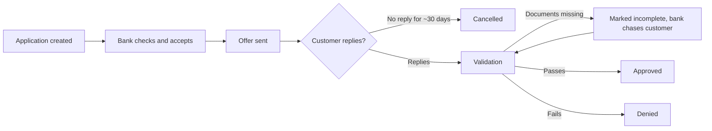
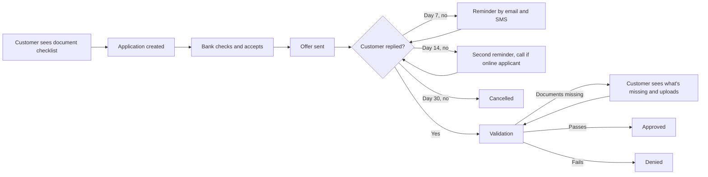

# Process: as-is and to-be

## As-is (2016, from the data)

What goes wrong today: after the offer is sent there's no contact, and many offers simply expire. During validation, most applications bounce back at least once because documents are missing.

## To-be (proposed)

What changes: customers know what to send before they apply, they're reminded before an offer expires, and they can fix missing documents themselves instead of waiting to be told.